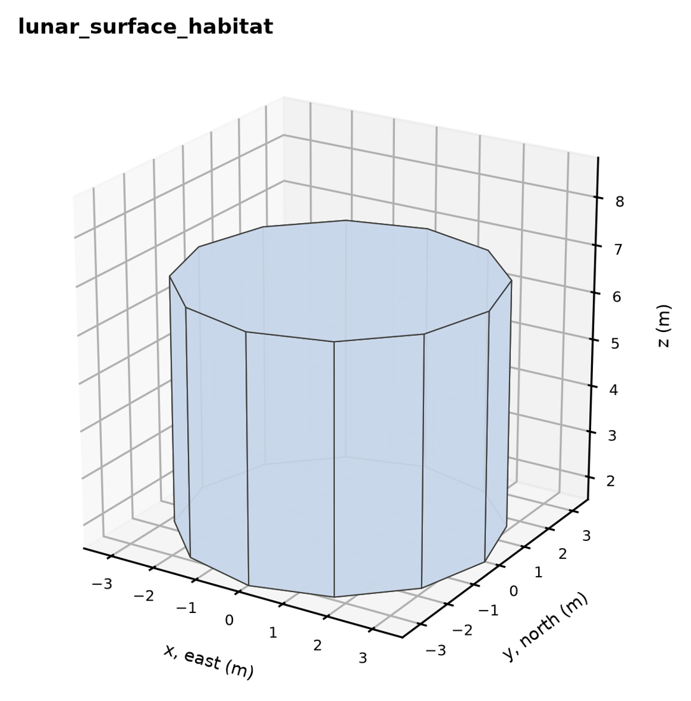
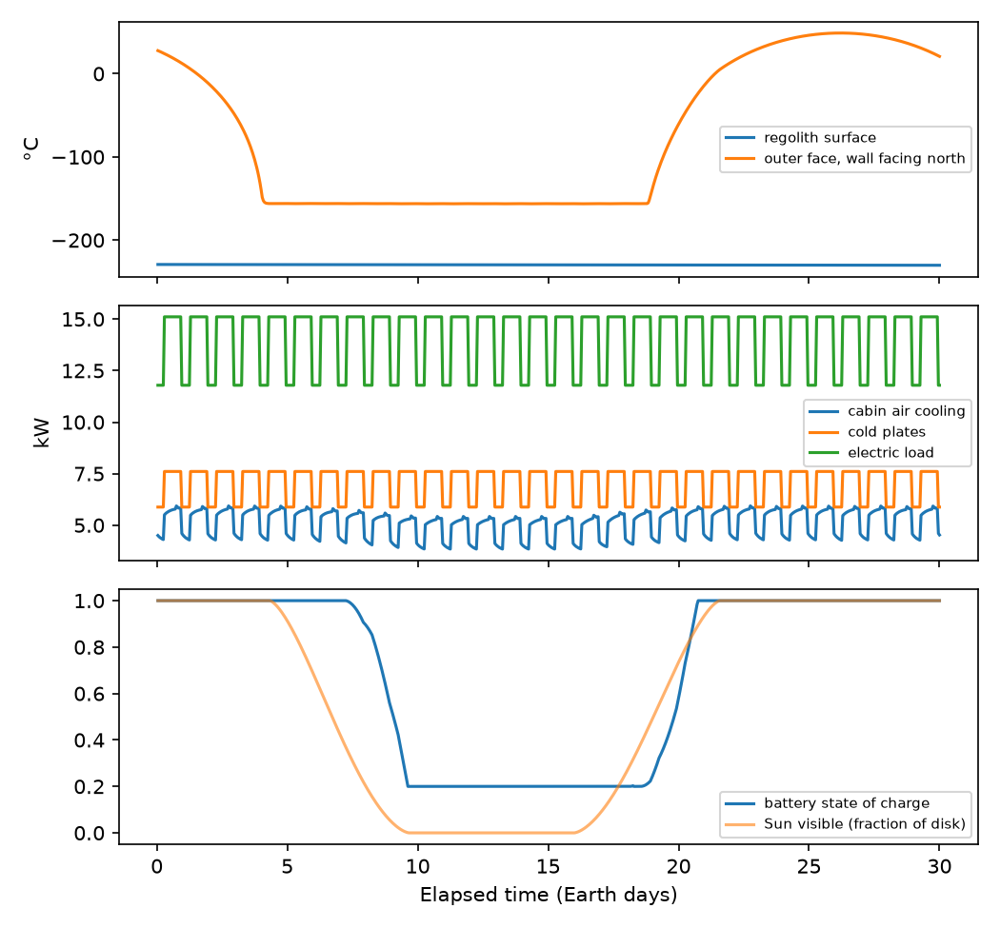

# ExoBEM tutorial: a lunar habitat in ten minutes

This tutorial walks through a complete study: install ExoBEM, create a weather file for a site near the lunar
south pole, simulate a four-crew habitat for 30 days, read the results, size its power system, and try a
design change. Every command and output below was run with ExoBEM 0.2.0.

## 1. Install

```bash
python -m pip install "exobem[plot] @ git+https://github.com/TensorBuildLab/ExoBEM"
exobem --version
```

(Details and other options: [INSTALL.md](../INSTALL.md).) Make a working folder and copy the example models into
it:

```bash
exobem examples my_lunar_study
cd my_lunar_study
```

```text
copied lunar_surface_habitat.json
copied mars_surface_habitat.json
```

## 2. Create the weather file

On the Moon there is no weather station, so ExoBEM generates the environment: the Sun from the lunar ephemeris, a
2.7 K sky, and the regolith surface and deep temperatures from a regolith model brought to equilibrium. The site
is a ridge at 89.5°S whose horizon lies 1.65° below the astronomical horizon. That gives about 92 % sunlight
over the year, but also a dark season. We start on 20 February 2030 to include a 12-day eclipse.

```bash
exobem weather --body moon --lat -89.5 --lon 0 --horizon -1.65 --start 2030-02-20T00:00:00 \
               --days 30 --timestep 3600 --site-name "Lunar south pole ridge" -o south_pole_30d.pwf
exobem info south_pole_30d.pwf
```

```text
                  body: moon
             start_utc: 2030-02-20T00:00:00
            timestep_s: 3600
          gravity_m_s2: 1.62500
            atmosphere: none
                 clock: earth_utc
               records: 720 x 3600 s = 30.00 Earth days
    ground temperature: 43.0 .. 43.9 K
           Sun visible: 79 % of records (any part of the disk)
         direct normal: mean 819.2, max 1392.4 W/m2
     global horizontal: mean 0.0, max 0.0 W/m2  (Sun below the astronomical horizon: flat ground is unlit)
```

The `.pwf` file is plain text: a header and one CSV record per hour. Its format is documented in
[weather_format.md](../weather_format.md). At this latitude the Sun skims the horizon, so flat ground stays
unlit and at about 43 K, while vertical surfaces and arrays still see the Sun 79 % of the time.

## 3. Look at the model

`lunar_surface_habitat.json` describes the four-crew habitat of the paper: a vertical cylinder 6.5 m in
diameter and 5.25 m high, 174 m³, standing on legs. Its sections are:

| Section | What it holds |
|---|---|
| `simulation` | name and time step (must equal the weather file's) |
| `site` | `{"weather_file": "south_pole_30d.pwf"}`, or parameters to generate the environment on the fly |
| `materials`, `constructions` | layers from outside to inside, e.g. beta cloth / MLI / aluminium / interior panel |
| `geometry` | `vertical_cylinder`, `horizontal_cylinder`, `dome` or `box`, with dimensions and the construction of each part |
| `zone` | cabin pressure and O₂ (56.5 kPa, 34 %), set-points (20–25 °C), leakage, airlock cycles, humidity limits (30–60 %), internal mass |
| `gains` | crew sensible and latent heat, life support, O₂ electrolysis, fans, lighting, equipment; each with a 24-hour schedule, `electric`, `heat_fraction` and `coldplate_fraction` |
| `thermal_control` | radiator area and orientation |
| `power` | PV arrays, battery, regenerative fuel cell and/or fission unit |

There is no infiltration: the habitat is sealed. If you add `"infiltration_ach"` to the zone, ExoBEM refuses
to run, because off-Earth there is no outdoor air. Plot the geometry:

```bash
exobem geometry lunar_surface_habitat.json -o habitat.png
```



## 4. Run it

```bash
exobem run lunar_surface_habitat.json -o out
```

The run takes under a second and writes four files to `out/`:

* `timeseries.csv`: zone and surface temperatures and loads at every step;
* `environment.csv`: the weather the run used;
* `power.csv`: generation, storage state of charge, and unmet and curtailed power;
* `summary.json`: totals, shown below.

```text
"cooling_kWh": 3684.9,                      cabin air sensible cooling over 30 days
"coldplate_kWh": 5061.6,                    equipment heat taken by cold plates
"latent_kWh": 154.8,                        condensing heat exchanger (crew moisture)
"thermal_control_electric_kWh": 108.0,      pumps only: radiators reject passively at the pole
"rh_min": 0.6, "rh_max": 0.6,
"min_surface_minus_dewpoint_K": 8.3,        no condensation risk
"cabin_gas_makeup_kg": 10.2,                leakage + airlock venting
"power": {"load_kWh": 10082, "pv_kWh": 14728, "unmet_kWh": 2611, "hours_unmet": 212, "battery_min_soc": 0.2}
```

The habitat is a heat-rejection problem: about 12 kW is collected on average, because the 14 kW of electric
power used inside the shell all ends up as heat. Much of it goes to cold plates rather than the cabin air. The
power system is not adequate: 100 m² of vertical PV and a 600 kWh battery cannot carry the 14 kW load through
the 12-day eclipse, and 2.6 MWh is unmet.

## 5. Use the Python interface

[`examples/tutorial/tutorial.py`](../../examples/tutorial/tutorial.py) repeats the run in Python, compares a
40 kWe fission unit and tests a design change. Copy it next to the model and weather file, then run it:

```bash
python tutorial.py
```

```text
ExoBEM 0.2.0: lunar_surface_habitat, 174 m3, 720 steps of 3600 s on the moon
cabin air cooling       122.8 kWh/day (peak 5.9 kW)
cold-plate heat         168.7 kWh/day
latent (condensate)       5.2 kWh/day, 7.6 kg water/day
cabin RH               0.60 - 0.60; coldest surface 8.3 K above the dew point
gas to make up         0.34 kg/day (leakage + airlock)
thermal control power     3.6 kWh/day
PV + battery: {... 'unmet_kWh': 2611.4, 'hours_unmet': 212.0, 'battery_min_soc': 0.2}
40 kWe fission: unmet 0.0 kWh; curtailed 18718 kWh
with a 1 m regolith cover: cabin cooling 146.1 kWh/day
wrote tutorial_results.png
```



The plot shows:
- **Top:** the north wall's outer face drops to −155 °C while the Sun is hidden.
- **Middle:** the cabin and cold-plate loads follow the crew day.
- **Bottom:** the battery drains to its 20 % floor during the eclipse.

The essential calls are:

```python
import json, exobem
from exobem.io import build_model, build_power, electric_load
from exobem.power import simulate_power
from exobem.weather import read_pwf

cfg = json.load(open("lunar_surface_habitat.json"))
env = read_pwf("south_pole_30d.pwf")
res = exobem.simulate(build_model(cfg), env)       # heat balance, humidity, thermal control
system, extra = build_power(cfg)
power = simulate_power(system, env, electric_load(res, extra), repeat_cycles=2)
print(res.summary(), power["summary"])
```

## 6. Things to try

* **Make the power system meet the load:**
  * set `"battery": {"capacity_kWh": 4500}`;
  * replace the PV and battery with `"fission": {"rated_kWe": 40, "efficiency": 0.181}`;
  * try a site with shorter eclipses.
* **Add a radiation shield.** Prepend `"lunar_regolith_cover_1m"` to the shell layers. The cover cuts the heat
  the habitat loses to space, so the cooling load rises (from 123 to 146 kWh/day).
* **Move to the equator.** Use `--lat 0.674 --lon 23.473 --days 59 --timestep 1800`, change `timestep_s` to
  1800, and watch the thermal-control electricity rise as the radiators need heat-pump lift during the hot
  lunar day.
* **Go to Mars.** `mars_surface_habitat.json` generates a Jezero-crater environment on the fly (`"planet":
  "mars"`) for a six-crew habitat with a fission power unit. Look at `condensation_risk_hours`: with aerogel
  insulation alone, the inner surfaces of a Mars habitat can fall below the dew point.

## Where next

* [weather_format.md](../weather_format.md): the planetary weather format.
* [planetary_factors.md](../planetary_factors.md): every Earth/Moon/Mars factor and how ExoBEM treats it.
* [energyplus_comparison.md](../energyplus_comparison.md): ExoBEM compared with EnergyPlus, element by element.
* `exobem.cases`: the Python versions of the paper's habitats, with the sources of every value.
